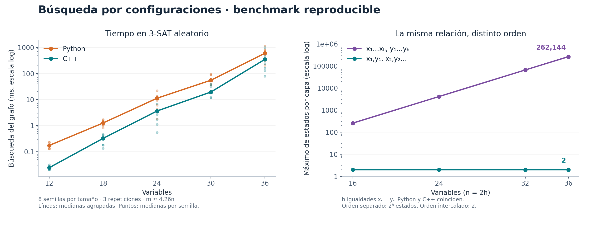

# Benchmark: búsqueda por configuraciones

Implementación del motor de la sección 3 del paper de Kaoru Aguilera Katayama (1 de octubre de 2026), con un adaptador CNF explícito y un control modular. La correspondencia y los supuestos están en README.md.

**348/348 ejecuciones con respuesta correcta**, sobre 58 casos distintos. 3 repeticiones por caso y lenguaje. Ningún timeout en esta corrida. Además, 929 comprobaciones previas superadas.

## Medición

- Fecha UTC: 2026-10-18T04:32:24.986053+00:00.
- CPU: AMD EPYC 9V74 80-Core Processor; un solo proceso a la vez, fijado al CPU [0].
- Python: 3.12.14 (main, Aug 25 2026, 14:00:49) [Clang 22.1.3 ].
- C++: g++ (Ubuntu 13.3.0-6ubuntu2~24.04) 13.3.0; `-O3 -DNDEBUG -std=c++17`.
- Todos los tiempos son medianas de tiempo de pared. Los solvers trabajan en un solo hilo.
- **Total interno** incluye lectura de CNF, preparación, grafo, reconstrucción y comprobación del certificado; excluye arranque, importaciones y serialización de salida.
- **Grafo** incluye solamente búsqueda y reconstrucción. Los tiempos de proceso completo también están en los CSV.
- Memoria: máximo residente `VmHWM` de Linux, en MiB; incluye runtime y entrada. No se resta una línea base.
- Procesos nuevos, orden de lenguajes alternado y una ejecución pequeña de calentamiento por lenguaje. Watchdog externo: 30 s por ejecución.

## 3-SAT aleatorio

Ocho instancias por tamaño, tres variables diferentes por cláusula, signos equiprobables y m = round(4.26n). La referencia de SAT/UNSAT es un DPLL independiente. Las medianas agrupan las ocho semillas y sus tres repeticiones: 24 observaciones por celda.

| Variables | Cláusulas | SAT / UNSAT | Python total (ms) | C++ total (ms) | Python grafo (ms) | C++ grafo (ms) | Estados/capa, mediana |
|---:|---:|---:|---:|---:|---:|---:|---:|
| 12 | 51 | 5 / 3 | 0.453 | 0.121 | 0.173 | 0.024 | 45 |
| 18 | 77 | 6 / 2 | 1.602 | 0.437 | 1.265 | 0.324 | 311 |
| 24 | 102 | 4 / 4 | 11.665 | 3.777 | 11.260 | 3.642 | 2,356 |
| 30 | 128 | 6 / 2 | 55.931 | 19.703 | 55.369 | 19.528 | 14,979 |
| 36 | 153 | 5 / 3 | 599.528 | 348.544 | 598.595 | 348.223 | 97,109.5 |

Las medianas de cantidades enteras pueden terminar en .5 al agregar un número par de instancias. Son estadísticas de varias fórmulas, no una cantidad fraccionaria de estados de una ejecución.

## CNF estructurados

Medianas de tres repeticiones por caso; tiempo total interno. Todas las igualdades son SAT. Las cadenas UNSAT fuerzan valores diferentes en dos extremos que deberían coincidir.

| Caso | Variables | Cláusulas | Python (ms) | C++ (ms) | Máximo de estados/capa |
|---|---:|---:|---:|---:|---:|
| Cadena SAT | 100 | 198 | 0.834 | 0.188 | 2 |
| Cadena SAT | 1,000 | 1,998 | 6.845 | 1.139 | 2 |
| Cadena SAT | 10,000 | 19,998 | 66.925 | 11.041 | 2 |
| Cadena UNSAT | 10,000 | 20,000 | 51.294 | 9.968 | 1 |
| Igualdades, orden separado | 16 | 16 | 0.589 | 0.147 | 256 |
| Igualdades, orden intercalado | 16 | 16 | 0.173 | 0.080 | 2 |
| Igualdades, orden separado | 24 | 24 | 7.550 | 1.035 | 4,096 |
| Igualdades, orden intercalado | 24 | 24 | 0.218 | 0.091 | 2 |
| Igualdades, orden separado | 32 | 32 | 134.308 | 17.746 | 65,536 |
| Igualdades, orden intercalado | 32 | 32 | 0.247 | 0.096 | 2 |
| Igualdades, orden separado | 36 | 36 | 605.948 | 93.196 | 262,144 |
| Igualdades, orden intercalado | 36 | 36 | 0.292 | 0.120 | 2 |

**Hallazgo:** con 18 igualdades xᵢ = yᵢ y 36 variables, leer primero todos los x conserva 262 144 estados diferentes; intercalar cada x con su y deja un máximo de dos. Es exactamente el mismo problema tras renombrar variables. Se observa una dependencia del orden y de la memoria del verificador, incluso para fórmulas sencillas de 2-SAT.

El aumento de 2^h es exacto para esta familia: después de leer los h valores de x, cada prefijo exige una continuación y diferente. Antes de leer y, esas memorias no se pueden fusionar con este orden y este estado.

## Control modular

Como máximo M residuos por capa y q = ceil(log2 M)² bits de certificado. Tiempo de grafo; este control no es SAT. La complejidad se expresa en M, no en la longitud binaria de M.

| M | q | Configuraciones totales | Python grafo (ms) | C++ grafo (ms) |
|---:|---:|---:|---:|---:|
| 64 | 36 | 2,047 | 0.970 | 0.089 |
| 256 | 64 | 14,847 | 7.492 | 0.671 |
| 1,024 | 100 | 94,207 | 54.820 | 4.650 |
| 4,096 | 144 | 548,863 | 323.512 | 28.872 |

Para M = 4096 y q = 144 hay 2^144 certificados posibles, pero la búsqueda visita 548 863 configuraciones. Este dato muestra la fusión efectiva de prefijos; no supone que SAT tenga un verificador con esas mismas cotas.

## Memoria residente

Medianas por lenguaje. Para 3-SAT se agregan semillas y repeticiones; las demás filas corresponden a un caso repetido tres veces.

| Caso | Python (MiB) | C++ (MiB) |
|---|---:|---:|
| 3-SAT aleatorio, n=36 | 37.40 | 31.68 |
| Cadena SAT, n=10 000 | 18.55 | 6.59 |
| Igualdades separadas, n=36 | 55.32 | 23.37 |
| Modular M=4096, q=144 | 15.62 | 6.00 |

## Corrección y alcance

- 512 fórmulas: todos los subconjuntos de las nueve cláusulas no tautológicas posibles sobre dos variables, incluida la vacía.
- 300 fórmulas aleatorias pequeñas contrastadas por tabla de verdad y DPLL; 14 casos de máscaras de más de 64 bits; ocho casos CNF de borde y un caso de parser multilínea.
- 84 controles modulares, siete rechazos de DIMACS inválido, dos pruebas de límites con respuesta UNKNOWN y una prueba de longitudes de certificado.
- En los CNF contrastados se comparan también certificados, ancho de cada capa, número de configuraciones y transiciones entre Python y C++.
- Cada testigo SAT del benchmark se comprueba contra el CNF original. Los UNSAT aleatorios se contrastan con DPLL y los estructurados se conocen por construcción. No se emiten certificados DRAT/LRAT de UNSAT.
- Son datos sintéticos y una muestra pequeña; no son una evaluación en SAT Competition ni una comparación con MiniSat, CaDiCaL o Glucose.
- La máquina es virtualizada; tres repeticiones no eliminan toda variación del anfitrión. Los tiempos muy cortos son especialmente sensibles al ruido.

El motor del paper funciona para el verificador que se le proporciona. El adaptador CNF aquí añadido puede requerir memoria creciente y exponencialmente muchos estados. Estos resultados no demuestran P=NP ni P≠NP; documentan una implementación ejecutable de la construcción y sus costes en verificadores concretos.

## Archivos y reproducción

```bash
python3 validate.py
python3 benchmark.py --cpu 0
python3 make_report.py
python3 plot_results.py
```

Los dos primeros pasos solo requieren Python y un compilador C++17. Matplotlib se usa únicamente en la figura opcional. Se incluyen todos los CNF, semillas, respuestas, hashes, entorno, observaciones y agregados en `instances/` y `results/`.


